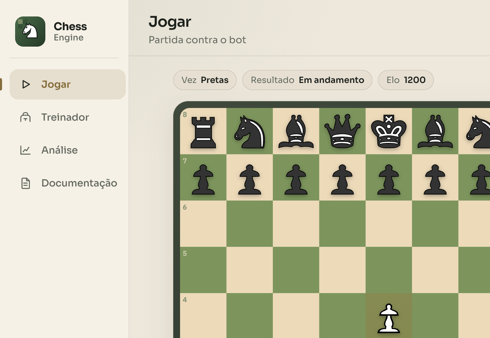
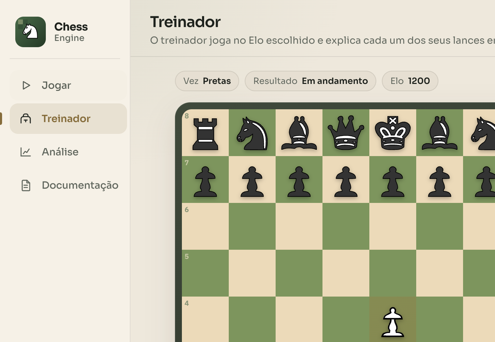
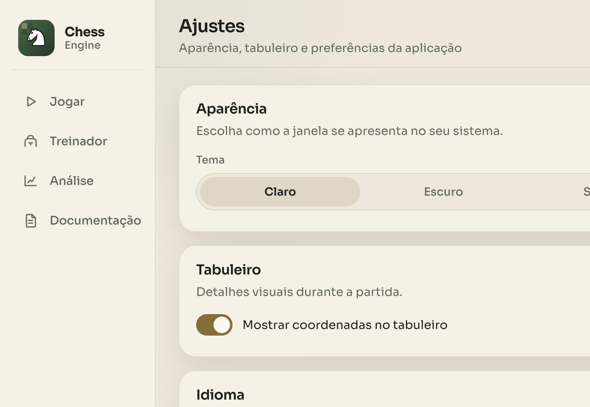
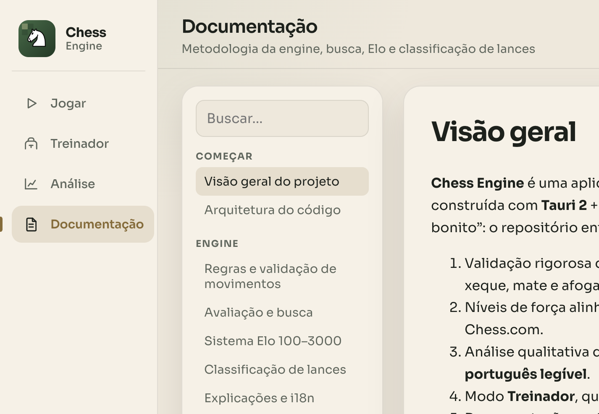

# Chess Engine

Desktop chess application with a **complete Rust engine**, Elo-scaled bots (100–3000), Chess.com-style move review with Portuguese explanations, coach mode, and an in-app methodology manual.

Stack: **Tauri 2** (native window on Linux / macOS / Windows) · **Rust** engine · **TypeScript** GUI.

> Code comments and module docs are in **English**. The UI is in **Portuguese**, with i18n hooks ready for more languages.

## Screenshots

Light theme (default):

| Jogar | Treinador |
| --- | --- |
|  |  |

| Ajustes | Documentação |
| --- | --- |
|  |  |

## Features

1. Legal move validation (castling, en passant, promotion, check, mate, stalemate)
2. Bot strength mapped to Elo **100–3000**
3. Per-move quality labels (brilliant → blunder) with readable Portuguese explanations
4. Coach mode: plays at the chosen Elo and teaches after each of your moves
5. Polished desktop GUI with light / dark themes and app icons
6. Large in-app documentation covering methodology and architecture

## Quick start

```bash
make deps   # install npm packages
make dev    # open the native app (Vite + Rust)
```

Other targets: `make help`, `make check`, `make test`, `make frontend`, `make typecheck`, `make icons`, `make clean`.

### Prerequisites

- Rust stable
- Node.js + npm
- [Tauri OS dependencies](https://v2.tauri.app/start/prerequisites/)

## Layout

```
frontend/          # Vite + TypeScript GUI
src-tauri/         # Rust engine + Tauri shell
  src/engine/      # board, movegen, eval, search, elo, analysis, coach
  src/i18n/        # explanation locales (pt today)
  src/api.rs       # Tauri commands
docs/screenshots/  # README captures (light theme)
Makefile           # local workflows
```

## No production deploy

This repository is aimed at local development and experimentation. There is no release/deploy pipeline by design.
